<!-- Graphics are generated by scripts/zg-build.mjs. The activity card refreshes hourly via .github/workflows/zg-refresh.yml. -->

  <a href="https://zana-g.com"><picture>
    <source media="(max-width: 560px), (min-width: 768px) and (max-width: 1000px)" srcset="./assets/zg-hero-mobile.svg">
    
  </picture></a>

  
  
  
  
  

<h3 align="center">Hi, I'm Zeno 🚴</h3>

Full-stack web + AI developer working from Philippines (GMT+8). I build fast, conversion-focused websites, Shopify stores, web apps and AI automations for agencies, startups and small businesses in the US, UK, AU, SG and DE.

  <picture>
    <source media="(max-width: 560px), (min-width: 768px) and (max-width: 1000px)" srcset="./assets/zg-band-a-mobile.svg">
    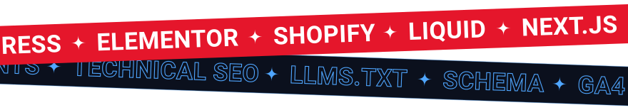
  </picture>

  <picture>
    <source media="(max-width: 560px), (min-width: 768px) and (max-width: 1000px)" srcset="./assets/zg-terminal-mobile.svg">
    
  </picture>

  <picture>
    <source media="(max-width: 560px), (min-width: 768px) and (max-width: 1000px)" srcset="./assets/zg-reach-mobile.svg">
    
  </picture>

  <a href="https://zana-g.com"><picture>
    <source media="(max-width: 560px), (min-width: 768px) and (max-width: 1000px)" srcset="./assets/zg-services-mobile.svg">
    
  </picture></a>

  <picture>
    <source media="(max-width: 560px), (min-width: 768px) and (max-width: 1000px)" srcset="./assets/zg-anatomy-mobile.svg">
    
  </picture>

  <picture>
    <source media="(max-width: 560px), (min-width: 768px) and (max-width: 1000px)" srcset="./assets/zg-stack-mobile.svg">
    
  </picture>

<picture></picture>

| Area | Tools |
| --- | --- |
| **Platforms** | WordPress + Elementor, Gutenberg, WooCommerce, Shopify (Liquid, theme dev, Shopify apps), GoHighLevel, Squarespace, Wix, Flatsome, Astra |
| **Full stack** | React, Next.js, TypeScript/JavaScript, HTML, CSS, Tailwind, PHP, Liquid, REST/GraphQL APIs, Node |
| **Agentic & AI** | n8n, MCP (Model Context Protocol), Claude Code, Claude, Cursor Agent, Codex, GitHub Copilot, OpenClaw, Hermes, ChatGPT, Gemini, Perplexity, DeepSeek |
| **Tracking & SEO** | GA4, GTM, Search Console, Google Business Profile, Meta Pixel, schema, llms.txt |
| **Ops** | Git, GitHub, cPanel, hosting, DNS, staging (Hostinger, GoDaddy Managed WP), Vercel |
| **Design** | Figma |

  <picture>
    <source media="(max-width: 560px), (min-width: 768px) and (max-width: 1000px)" srcset="./assets/zg-band-b-mobile.svg">
    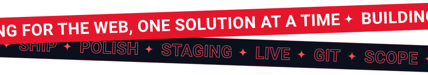
  </picture>

  <picture>
    <source media="(max-width: 560px), (min-width: 768px) and (max-width: 1000px)" srcset="./assets/zg-flow-ai-mobile.svg">
    
  </picture>

  <picture>
    <source media="(max-width: 560px), (min-width: 768px) and (max-width: 1000px)" srcset="./assets/zg-flow-tracking-mobile.svg">
    
  </picture>

  <a href="https://zana-g.com/#zeno-cases"><picture>
    <source media="(max-width: 560px), (min-width: 768px) and (max-width: 1000px)" srcset="./assets/zg-work-mobile.svg">
    
  </picture></a>

  <picture>
    <source media="(max-width: 560px), (min-width: 768px) and (max-width: 1000px)" srcset="./assets/zg-process-mobile.svg">
    
  </picture>

<!-- zg-activity:start -->

  <picture>
    <source media="(max-width: 560px), (min-width: 768px) and (max-width: 1000px)" srcset="./assets/zg-activity-mobile.svg">
    
  </picture>

<picture></picture>

| Week of | Contributions |
| --- | --: |
| Oct 4 | 1 |
| Oct 25 | 2 |
| Nov 1 | 394 |
| Nov 8 | 24 |

<!-- zg-activity:end -->

  <a href="https://zana-g.com/#zeno-contact"><picture>
    <source media="(max-width: 560px), (min-width: 768px) and (max-width: 1000px)" srcset="./assets/zg-contact-mobile.svg">
    
  </picture></a>

<picture></picture>

#### Right now

- 🔭 Building **Zana-G** into a web development, SEO and AI agency
- 🤖 Shipping agentic workflows with Claude Code, MCP servers and n8n
- 🌱 Going deeper on Next.js, headless commerce and LLM features for client sites
- 💬 Ask me about Shopify Liquid, Elementor at scale, llms.txt and AI-crawler readiness, or conversion tracking that actually fires

#### What I build

| Area | What I build |
| --- | --- |
| **WordPress & Elementor** | Full site builds, custom themes and plugins, WooCommerce, mobile and speed fixes |
| **Shopify** | Theme development, custom Liquid sections, bundles, print-on-demand, interactive 3D/360° product viewers |
| **Full-stack** | React and Next.js apps, headless WordPress/Shopify, REST and GraphQL APIs, Vercel deploys |
| **AI & automation** | n8n workflows, AI agents, MCP servers, lead routing and AI-drafted replies |
| **Technical SEO** | Schema (JSON-LD), Core Web Vitals, internal linking, llms.txt and AI-crawler optimization |
| **Tracking** | GA4, Google Tag Manager, Meta Pixel, booking and form conversion tracking |

#### Recent work

- 🛒 Full Shopify store with custom Liquid sections, Printful and product bundles
- 🎱 Shopify landing page with an interactive 360° product viewer, parallax and scroll animations
- 🏥 Healthcare WordPress/Elementor build with schema and technical SEO
- ⚖️ Law firm site: attorney profiles, mobile fixes and internal linking
- 🤖 llms.txt and AI-crawler optimization for a professional services firm
- 📈 Booking and Meta Pixel conversion tracking for a salon

Full case studies on [zana-g.com](https://zana-g.com/#zeno-cases).

#### How I work

Scope and a clear definition of "done" first. Ship a working version early, then polish. Staging before live, everything in Git.

📫 Open to freelance, contract and agency roles: [zana-g.com](https://zana-g.com/#zeno-contact)

